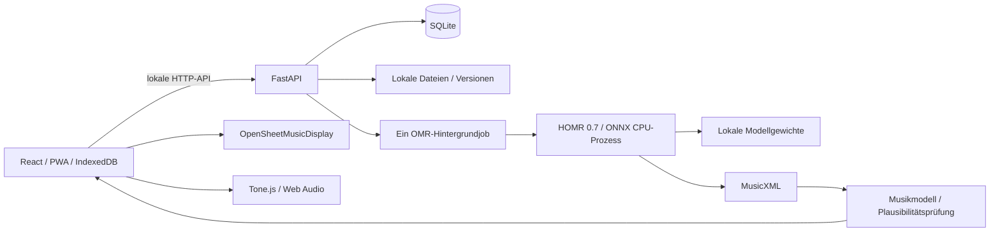

# Architektur

## Daten und Musik

MusicXML ist die persistierte Notationsquelle. `backend/app/services/score.py` erzeugt daraus Takte, Ereignisse, Warnungen und eine expandierte Wiedergabe-Zeitachse. Brüche werden intern mit `Fraction` gerechnet, Audio erhält Viertelschlagpositionen. Backup/Forward, Akkorde, Stimmen und Systemwechsel werden gelesen. XML-Tonhöhen, Tonart/Versetzungszeichen, Oktavlage und Transpositionsangaben werden getrennt behandelt. Die Anzeige deutscher H/B-Namen beeinflusst keine MIDI-Werte.

Korrekturen erzeugen neue MusicXML-Dateien und einen neuen `score_versions`-Datensatz. Ein vorhandener `version_id` verhindert versehentliche Änderungen an einer inzwischen ersetzten Version. Die stabile Note-ID ist im XML gespeichert; Grafikzuordnung verwendet Stimme, Position und Ton. Das ursprüngliche XML bleibt in der Versionshistorie. Die Frontend-Zeitachse integriert Tempoänderungen auch innerhalb gehaltener Noten und begrenzt Ties am Übungsabschnitt.

SQLite nutzt Foreign Keys, WAL, ein Connection-Objekt pro Operation und kurze Transaktionen. Neustart markiert unterbrochene Erkennungsjobs als fehlgeschlagen. Dateien sind UUID-basiert und bleiben unter dem konfigurierten Datenordner. API-Dokumentation ist lokal unter `/docs` verfügbar. Ohne Authentifizierung teilen Geräte im aktivierten LAN dieselbe Bibliothek.

## Erkennung

`recognize_score(input_document, options)` kapselt den Engine-Prozess. Eingabe wird in einen temporären Arbeitsordner kopiert, Prozessstatus und Timeout werden überwacht, Ausgabe wird als tatsächlich erzeugtes MusicXML gelesen und validiert. Abbruch beendet den aktiven Prozess; keine Dummy-Noten als Fallback. Seiten werden nur bei gleicher Stimmenzahl in Reihenfolge zusammengeführt. Unterschiedliche Besetzungen müssen einzeln geprüft werden.

Der HOMR-Adapter verwendet die veröffentlichte Version 0.7.0. Diese schreibt ohne Adapter Gewichte in Paketverzeichnisse und erzeugt zusätzliche Config-Instanzen. Der versionierte Runner bindet deren Modellpfade zur Laufzeit an `data/models`, ohne HOMR-Quelldateien zu verändern. Neuere HOMR-Versionen müssen eigens getestet werden. Audiveris/oemer sind nicht als scheinbar verfügbare Engines aufgeführt.

## Ressourcen und Dateisicherheit

40-MB-Uploadlimit, 30 Bildseiten pro Stück, 35 Millionen Pixel pro Bild und 12 MB entpacktes MusicXML. DefusedXML blockiert externe Entitäten; MXL-ZIPs werden auf Pfade und entpackte Größe geprüft und nicht blind extrahiert. PDFium rendert Seiten, ohne Dokument-Skripte auszuführen. Jobs haben ein konfigurierbares 900-Sekunden-Zeitlimit pro Seite und einen einzelnen Worker. Native CPU-Threads werden begrenzt; keine verpflichtende GPU.

Backups enthalten einen SQLite-Snapshot; Wiederherstellung prüft Archivpfade, Größe, bekannte Tabellen, identisches Schema, Fremdschlüssel und referenzierte Dateien. Trigger und Views werden abgelehnt. Aufnahmebearbeitung arbeitet vom erhaltenen Original aus.

## Betrieb und Grenzen

Ein Serverprozess, eine lokale Datenbank, kein Redis/PostgreSQL oder externer KI-Dienst. PWA-App-Shell und explizit geöffnete JSON-/XML-Partituren sind lokal gecacht; originale Fotoansicht und neue Erkennungen brauchen den Server. Vite dient nur der Entwicklung. Der Produktionsbuild wird von FastAPI am selben Origin ausgeliefert.
